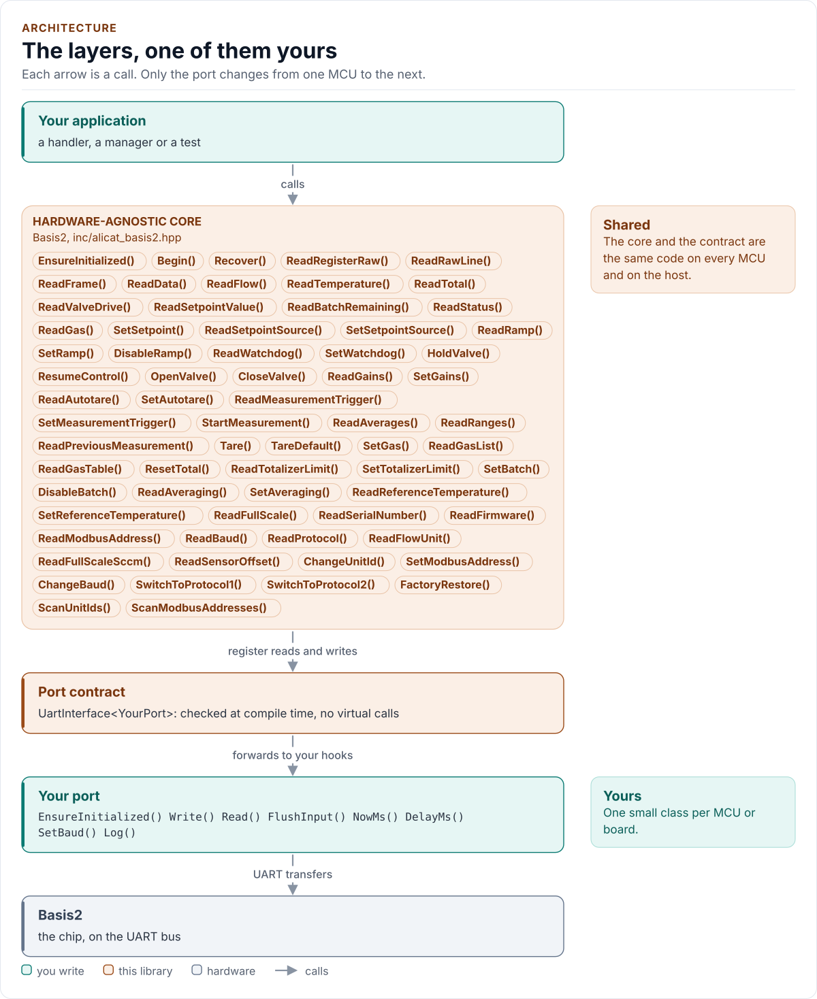
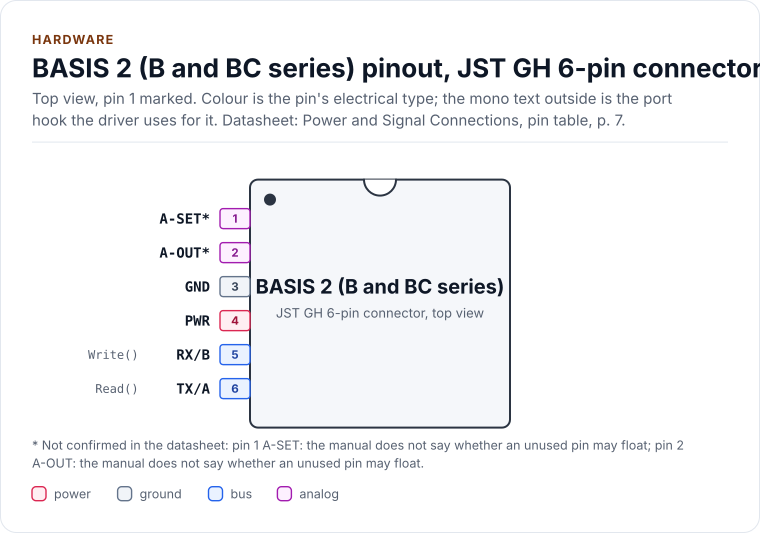
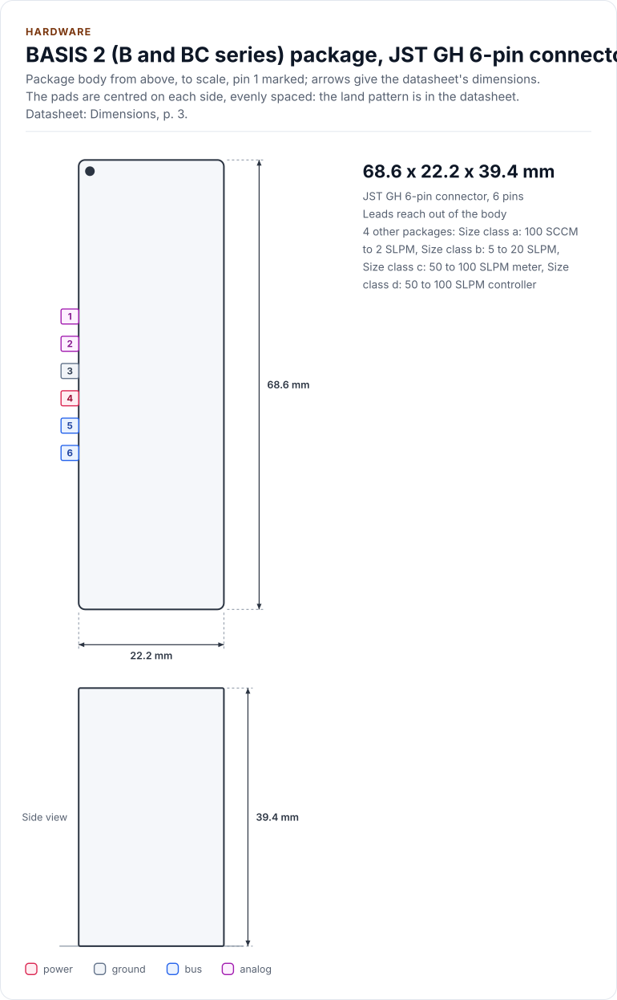
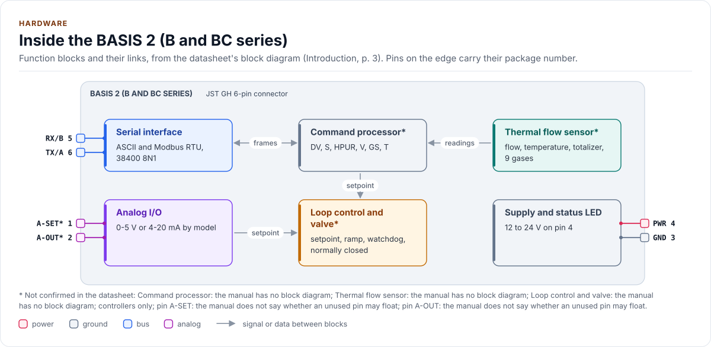

# BASIS 2 Driver

C++20 driver for the Alicat BASIS 2 gas mass flow meters (B series) and controllers (BC series) over a serial line, with
the ASCII protocol and Modbus RTU behind one API.

[](https://github.com/kokeb-labs-drivers/driver-alicat-basis2/actions/workflows/ci.yml)
[](LICENSE)
[](docs/installation.md#requirements)

**Documentation: [`docs/`](docs/index.md)**, with the API reference built by Doxygen ([how](docs/api-reference.md)).
The site at <https://kokeb-labs-drivers.github.io/driver-alicat-basis2/> opens when the repository is public.


The BASIS 2 instruments measure the mass flow of nine gases from 100 SCCM to 100 SLPM, and a controller sets the flow
with a valve. This driver reads flow, temperature and totals, sets setpoints, ramps and valve holds, scans for
instruments and recovers a lost one, and guards the commands that can strand an instrument. It runs on any MCU: you
give it a small class that moves bytes on a serial line and tells the time, and it does the rest. **Not verified on
hardware yet.**

<!-- figure: driver-layers -->
<picture>
  <source media="(prefers-color-scheme: dark)" srcset="docs/diagrams/driver-layers.dark.svg">
  
</picture>
<!-- /figure -->

## At a glance

| | |
| --- | --- |
| **Instrument** | Alicat BASIS 2 B-series meter or BC-series controller, 12 to 24 V on pin 4 only |
| **Measures** | Mass flow, temperature and total of nine gases; controllers add setpoint, ramp, valve and batch |
| **Line** | RS-232 or RS-485 by model, 38400 baud 8N1 by default, up to 26 instruments with unit IDs A to Z |
| **Protocols** | ASCII "BASIS Protocol 2" (default) and Modbus RTU, both complete, one typed API |
| **Safety** | Six commands that can strand an instrument sit behind confirmation tokens; reads retry, writes never do |
| **Driver** | Header-only C++20; no heap, exceptions, RTTI or virtual calls; every call returns `Result<T>` |
| **Runs on** | Any MCU with a UART and a C++20 compiler; the host example runs on any PC ([Platforms](docs/platforms.md)) |
| **Status** | 0.1.0, not yet verified on hardware: host-tested against an independent model instrument |

<!-- figure: chip-pinout -->
<picture>
  <source media="(prefers-color-scheme: dark)" srcset="docs/diagrams/chip-pinout.dark.svg">
  
</picture>
<!-- /figure -->

<!-- figure: chip-outline -->
<picture>
  <source media="(prefers-color-scheme: dark)" srcset="docs/diagrams/chip-outline.dark.svg">
  
</picture>
<!-- /figure -->

<!-- figure: chip-blocks -->
<picture>
  <source media="(prefers-color-scheme: dark)" srcset="docs/diagrams/chip-blocks.dark.svg">
  
</picture>
<!-- /figure -->

<!-- generated: chip-card -->
| | | Datasheet |
| --- | --- | --- |
| **Package** | JST GH 6-pin connector | Power and Signal Connections, pin table, [p. 7](https://documents.alicat.com/manuals/DOC-MANUAL-BASIS2.pdf#page=7) |
| **Pins** | 6 | Power and Signal Connections, pin table, [p. 7](https://documents.alicat.com/manuals/DOC-MANUAL-BASIS2.pdf#page=7) |
| **Body size** | 68.6 x 22.2 x 39.4 mm | Dimensions, [p. 3](https://documents.alicat.com/specifications/DOC-SPECS-BASIS.pdf#page=3) |
| **Variants** | `a`, `b`, `c`, `d` (below) | Dimensions, [p. 3](https://documents.alicat.com/specifications/DOC-SPECS-BASIS.pdf#page=3) |
| **Supply PWR** | 12.0 V to 24.0 V | Power and Signal Connections, [p. 6](https://documents.alicat.com/manuals/DOC-MANUAL-BASIS2.pdf#page=6) |

Also sold as:

| Variant | Package | Pins | Size | Ordering | Note | Datasheet |
| --- | --- | --- | --- | --- | --- | --- |
| `a` | Size class a: 100 SCCM to 2 SLPM | 6 | 68.6 x 22.2 x 39.4 mm, about 116 g | 1/8 in NPT female or SAE 4 | - | Dimensions, [p. 3](https://documents.alicat.com/specifications/DOC-SPECS-BASIS.pdf#page=3) |
| `b` | Size class b: 5 to 20 SLPM | 6 | 84.0 x 25.4 x 45.7 mm, about 171 g | 3/8 in NPT female or SAE 6 | - | Dimensions, [p. 3](https://documents.alicat.com/specifications/DOC-SPECS-BASIS.pdf#page=3) |
| `c` | Size class c: 50 to 100 SLPM meter | 6 | 95.3 x 35.0 x 48.4 mm, about 270 g | 3/8 in NPT female or SAE 6 | - | Dimensions, [p. 3](https://documents.alicat.com/specifications/DOC-SPECS-BASIS.pdf#page=3) |
| `d` | Size class d: 50 to 100 SLPM controller | 6 | 114.8 x 35.0 x 52.3 mm, about 350 g | 3/8 in NPT female or SAE 6 | options by model, not by size: analog 0-5 V or 4-20 mA; serial RS-232, RS-485 or Modbus RTU | Dimensions, [p. 3](https://documents.alicat.com/specifications/DOC-SPECS-BASIS.pdf#page=3) |

From [`docs/hardware.yml`](docs/hardware.yml); pins, circuits and the block diagram: [Hardware](docs/hardware.md).
<!-- /generated -->

## Datasheet

<!-- generated: datasheet-card -->
| Document | Revision | Get it |
| --- | --- | --- |
| Datasheet manual: Operating Manual for Mass Flow Instruments, BASIS 2 Meters and Controllers (Alicat Scientific, Inc. DOC-MANUAL-BASIS2) | Rev 4, 2025-05-23 | [PDF](https://documents.alicat.com/manuals/DOC-MANUAL-BASIS2.pdf) · [vendor page](https://www.alicat.com/basisoem) |
| Datasheet specification sheet: Technical Data for BASIS 2.0 Mass Flow Meters and Controllers (Alicat Scientific, Inc. DOC-SPECS-BASIS) | Rev 19, 2026-08-17 | [PDF](https://documents.alicat.com/specifications/DOC-SPECS-BASIS.pdf) · [vendor page](https://www.alicat.com/basisoem) |
| Datasheet specification sheet: Technical Data for BASIS 2 (pages 1 to 3 of the combined manual and specification file) (Alicat Scientific, Inc. MANUAL+SPECS_BASIS2) | Rev 16, 2024-03-01 | [PDF](https://documents.alicat.com/specifications/MANUAL+SPECS_BASIS2.pdf) · [vendor page](https://www.alicat.com/basisoem) |
| Datasheet manual: Alicat Modbus Manual (generic, written for the classic registers) (Alicat Scientific, Inc. DOC-MANUAL-MODBUS) | Rev 7, 2024-11-01 | [PDF](https://documents.alicat.com/manuals/DOC-MANUAL-MODBUS.pdf) · [vendor page](https://www.alicat.com/basisoem) |
| Datasheet application note: Alicat Serial Communications Primer (classic line, firmware 4v to 10v) (Alicat Scientific, Inc. Alicat-Serial-Primer) | Rev 2, 2023-02-01 | [PDF](https://documents.alicat.com/Alicat-Serial-Primer.pdf) · [vendor page](https://www.alicat.com/basisoem) |

Written against these revisions; the SHA-256 of each file is in [`docs/datasheets.yml`](docs/datasheets.yml). Where each
part of the driver is in the datasheet: [Datasheet map](docs/datasheet.md).
<!-- /generated -->

Every docs page lists the datasheet sections it relies on, and code comments cite the section they implement.

## Try it on your PC

No hardware needed: [`examples/host`](examples/host/README.md) runs the driver against a simulated instrument.
You need git, CMake 3.16+ and a C++20 compiler (GCC 10+, Clang 13+ or MSVC 2022).

1. Get the source:

   ```bash
   git clone https://github.com/kokeb-labs-drivers/driver-alicat-basis2.git && cd driver-alicat-basis2
   ```

2. Build and run the example:

   ```bash
   cmake -S examples/host -B build-example
   cmake --build build-example
   ./build-example/alicat_basis2_host_example
   ```

3. It runs five scenarios (read the flow, ramp a controller, tare and totalize, scan the line, read over Modbus) and
   exits with 0 when every call succeeded.

To run the whole test suite instead: `cmake -S . -B build -DALICAT_BASIS2_BUILD_TESTS=ON && cmake --build build && ctest
--test-dir build`.

## Use it on your MCU

**1. Wire it** ([Hardware](docs/hardware.md) has the connector, both circuits and the warnings):

| MCU | Instrument connector | Notes |
| --- | --- | --- |
| UART TX | pin 5 (RX or B) | 38400 baud, 8N1; RS-232 or RS-485 levels by model: a level shifter or a transceiver |
| UART RX | pin 6 (TX or A) | |
| 12 to 24 V supply | pin 4 | **Power on pin 4 only** |
| Ground | pin 3 | One common ground |

**2. Write the port**: a class with `EnsureInitialized()` (bring the UART up), `Write()`, a partial `Read()`,
`FlushInput()` and `NowMs()`, about 30 lines on most SDKs. [Porting](docs/porting.md) has the contract, RS-485 and a
complete example.

**3. Read the flow:**

<!-- generated: quickstart-code -->
```cpp
#include "alicat_basis2.hpp"

int read_flow(MyPort& port, double& flow) {
  alicat_basis2::Bus<MyPort> bus(port);
  alicat_basis2::Basis2<MyPort> meter(bus); // unit ID 'A', 38400 baud, ASCII: the factory settings

  if (auto r = meter.EnsureInitialized(); !r) { // 1. the port comes up; no traffic yet
    return static_cast<int>(r.error);
  }
  if (auto r = meter.Begin();
      !r) { // 2. learn the instrument: Timeout means check wiring and unit ID
    return static_cast<int>(r.error);
  }
  const auto f = meter.ReadFlow(); // 3. one poll
  if (!f) {
    return static_cast<int>(f.error);
  }
  flow = f.value.ToDouble(); // in the instrument's flow unit
  return 0;
}
```
<!-- /generated -->

`EnsureInitialized()` only brings the port up. `Begin()` learns the instrument with read commands. Every other call
returns an error until both have succeeded, and no call starts the instrument on its own.

## What it does

- Reads the full data frame or single items; decodes numbers exactly (`Decimal`), flags and gas; rejects what the
  grammar does not allow and what cannot be physical.
- Sets setpoints (checked, read back, rate limited on the saved source), ramps, valve holds, tare, gas, totalizer and
  batch, averaging and measurement windows.
- Frames a transaction by the rules of the line: the 3.5 character gap, deadlines from the baud rate, quarantine after a
  failure so a late reply is never taken for the next answer, stray line detection.
- Speaks ASCII and Modbus RTU (functions 3, 6 and 16, CRC-16, the register table with firmware gates).
- Guards the six commands that change the unit ID, the Modbus address, the baud rate, the protocol or the factory
  settings; recovers a lost instrument by scanning.
- Returns `Result<T>` with an `Error` from every call: no exceptions, no heap, no RTTI, no virtual calls.

## Add it to your project

Pick the row that matches your build; each is a few steps, and [Installation](docs/installation.md) has the
details.

| Your build | Steps below |
| --- | --- |
| Plain CMake: STM32 (CubeMX), RP2040 (Pico SDK), nRF Connect, a host app | [A](#a-cmake-any-mcu) |
| ESP-IDF | [B](#b-esp-idf) |
| An SDK or OS image that installs libraries | [C](#c-installed-package) |

### A. CMake, any MCU

1. Add the driver as a submodule, pinned to the version you chose:

   ```bash
   git submodule add https://github.com/kokeb-labs-drivers/driver-alicat-basis2.git external/driver-alicat-basis2
   ```

2. In your `CMakeLists.txt`, after `project()`:

   ```cmake
   add_subdirectory(external/driver-alicat-basis2)
   target_link_libraries(my_app PRIVATE alicat_basis2::alicat_basis2)   # brings the headers and C++20
   ```

3. In your code, `#include "alicat_basis2.hpp"`, write the port ([Porting](docs/porting.md)) and build. A first build
   that compiles the quickstart above is the check that the driver is wired in.

### B. ESP-IDF

1. Add the driver under your project's `components/`; ESP-IDF finds it there and names it after the folder:

   ```bash
   git submodule add https://github.com/kokeb-labs-drivers/driver-alicat-basis2.git components/alicat_basis2
   ```

2. In `main/CMakeLists.txt`, list it: `idf_component_register(SRCS "main.cpp" REQUIRES alicat_basis2)`.
3. `idf.py menuconfig` now has a **ALICAT_BASIS2 mass flow meter** menu (protocol, baud rate, timing, retries),
   and `idf.py build` builds the driver with your app. [`examples/esp32`](examples/esp32) is a complete
   project with a port.

### C. Installed package

1. Install it once into a prefix:

   ```bash
   cmake -S external/driver-alicat-basis2 -B build-alicat_basis2 && cmake --install build-alicat_basis2 --prefix /opt/sdk
   ```

2. In your project, with `CMAKE_PREFIX_PATH=/opt/sdk`:

   ```cmake
   find_package(alicat_basis2 0.1 REQUIRED)
   target_link_libraries(my_app PRIVATE alicat_basis2::alicat_basis2)
   ```

The target is `alicat_basis2::alicat_basis2` every way, so switching later changes nothing else.

## Documentation

| Page | Read it when you want to |
| --- | --- |
| [Quickstart](docs/quickstart.md) | Go from a bare instrument to a flow reading on your MCU |
| [Hardware](docs/hardware.md) | Wire it: the connector, RS-232 and RS-485, power, LED, size classes |
| [Safety notes](docs/safety.md) | Know what moves a valve, what the watchdog does not do, and the guarded commands |
| [Protocols](docs/protocols.md) | See the ASCII and Modbus RTU protocols side by side, with the timing |
| [Porting](docs/porting.md) | Write the port class for your MCU's SDK, including RS-485 and baud switching |
| [API guide](docs/api-guide.md) | Use each call: start, read, set, scan, recover, handle errors |
| [Configuration](docs/configuration.md) | Choose every setting; the required Modbus decimals |
| [Troubleshooting](docs/troubleshooting.md) | Find the cause of an error or a wrong reading |
| [Contract](docs/contract.md) | Know exactly what the driver promises, needs and returns |
| [Datasheet map](docs/datasheet.md) | Find the manual section behind each part of the driver, and the open assumptions |
| [API reference](docs/api-reference.md) | Look up a class or member (Doxygen; built by CI and locally) |

## Tests and quality

```bash
cmake -S . -B build -DALICAT_BASIS2_BUILD_TESTS=ON && cmake --build build && ctest --test-dir build
```

The host tests run the driver against an independent model of the instrument and its serial wire, fail and corrupt
every transfer, and produce each error the driver can return. Four fuzzers feed the driver arbitrary replies and random
call sequences and check fourteen invariants after every call (two more are unit tests): nothing outside the grammar
is ever sent, no guarded command without its token, no write while a reply is pending. CI also builds for Cortex-M
and gates coverage, complexity, sanitizers, fuzzing, clang-tidy, cppcheck and the handbook rules
(`.kokeb/handbook.yml`). See [Testing and CI](docs/testing.md), which lists every gate and its limit.

## License

MIT. See [LICENSE](LICENSE).
