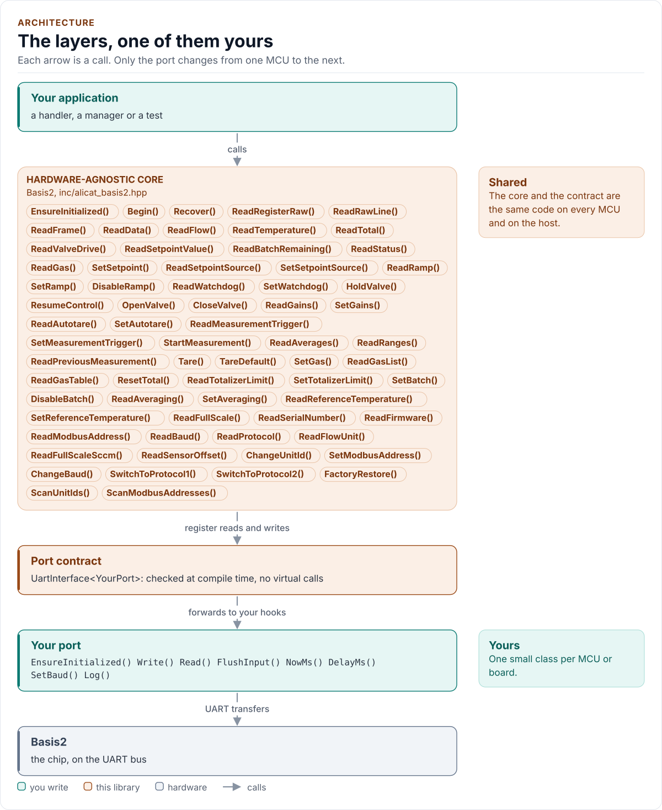
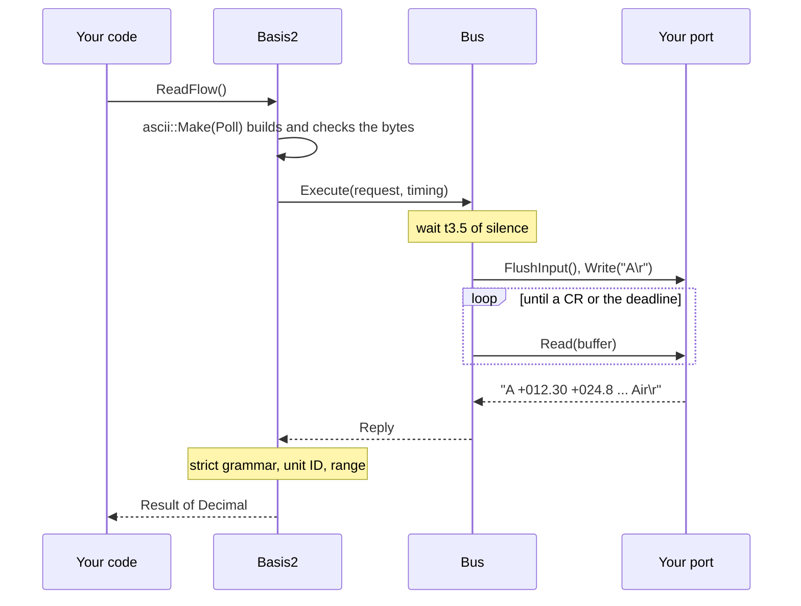

# Architecture

How the driver is built: a serial bus that owns the line, an instrument object on top of it, and a port you write.
What happens in each layer when you read a flow.

<!-- generated: datasheet-refs -->
??? abstract "Datasheet sections this page relies on"

    From Alicat Scientific, Inc. DOC-MANUAL-BASIS2 Rev 4:

    - Default serial settings and the link layer: Alicat ASCII Serial Communication, Establishing Communication, [p. 10](https://documents.alicat.com/manuals/DOC-MANUAL-BASIS2.pdf#page=10)
    - Modbus RTU framing, address and baud: Modbus-RTU; Communicating Via Modbus-RTU; Changing the Baud Rate, [p. 18](https://documents.alicat.com/manuals/DOC-MANUAL-BASIS2.pdf#page=18)

    All of them, with the driver API for each: [Datasheet map](datasheet.md).
<!-- /generated -->

<!-- figure: driver-layers -->
<picture>
  <source media="(prefers-color-scheme: dark)" srcset="diagrams/driver-layers.dark.svg">
  
</picture>
<!-- /figure -->

## Layers

| Layer | Files | Owns |
| --- | --- | --- |
| Instrument | [`inc/alicat_basis2.hpp`](../inc/alicat_basis2.hpp), [`src/alicat_basis2.ipp`](../src/alicat_basis2.ipp) | `Basis2<Port>`: one instrument; the typed API, learning, verification, guarded commands, scans |
| Bus | [`inc/alicat_basis2_uart_interface.hpp`](../inc/alicat_basis2_uart_interface.hpp), [`src/alicat_basis2_bus.ipp`](../src/alicat_basis2_bus.ipp) | `Bus<Port>`: one serial line, one transaction at a time, timing, quarantine, stray bytes |
| Codecs | [`inc/alicat_basis2_ascii.hpp`](../inc/alicat_basis2_ascii.hpp), [`inc/alicat_basis2_modbus.hpp`](../inc/alicat_basis2_modbus.hpp), [`inc/alicat_basis2_request.hpp`](../inc/alicat_basis2_request.hpp) | Request factories, reply grammars, CRC-16, the independent wire validators |
| Types and registers | [`inc/alicat_basis2_types.hpp`](../inc/alicat_basis2_types.hpp), [`inc/alicat_basis2_registers.hpp`](../inc/alicat_basis2_registers.hpp) | `Error`, `Result`, `Config`, `Decimal`, `Frame`, the Modbus register table |
| Port contract | [`inc/alicat_basis2_uart_interface.hpp`](../inc/alicat_basis2_uart_interface.hpp) | The CRTP base and the `UartPort` concept |
| Platform port | Your class | The UART, the clock, optionally a delay, a baud switch and logging |
| Kconfig layer | [`inc/alicat_basis2_kconfig.hpp`](../inc/alicat_basis2_kconfig.hpp) | Optional: a `Config` from ESP-IDF menuconfig |

`Bus` knows the line, not the instrument; `Basis2` knows the instrument, not the timing. Several `Basis2` objects share
one `Bus` when instruments share a line, and the bus lets one transaction run at a time.

## One call through the layers

## The transaction machine

A transaction is submitted, advanced by `Poll()` and taken. `Execute()` does the three steps and waits with `DelayMs()`
when the port has it, or spins on `NowMs()`. The states are `Idle`, `Gap`, `AwaitReply` and `Settling`.

1. **Gap.** The line must have been silent for 3.5 character times (`35 / baud` seconds at ten bits per character,
   at least 1 ms) since the last byte in either direction. The instrument acts on a command only after its own 3.5
   character idle time following the carriage return (manual p. 10).
2. **Send.** `FlushInput()`, then `Write()`. A `false` from `Write()` is `Error::Bus` and nothing is pending.
3. **Await.** Each `Poll()` reads what has arrived and appends it to a 256-byte line buffer until a carriage return or
   the deadline: 3.5 character times plus the line time of the longest reply plus `processing_ms`, or `slow_command_ms`
   for the commands that may write non-volatile memory.
4. **Settle.** After a timeout, an overflow, a bad line or a wrong-ID reply the bus holds for at least one reply-wait and
   then until the line has been quiet for 3.5 character times plus 2 ms, with a hard deadline of two reply-waits. No
   command is sent until then, so a late reply of the failed command cannot be taken for the answer of the next one.
   A command with a known busy period (tare, factory restore, a timed valve hold) holds the bus for that period.
5. **Stray bytes.** While no transaction waits, bytes that arrive are drained and counted
   (`StrayLineCount()`); a line that begins with `@` sets `StreamingSuspected()`. They are never used as an answer.

Retries apply to reads only. Over ASCII a read retries after bus-level failures (timeout, overflow); over Modbus it also
retries a frame with a bad CRC, a wrong address or a malformed reply. A write, a guarded command or anything with a
side effect is sent once.

## Request, codec and validator

A `Request` has no public constructor. It is made only by `ascii::Make()` or the `modbus::Build*()` functions, which
check every argument and produce the wire bytes in one place. `ascii::IsLegalRequest()` and
`modbus::IsLegalModbusRequest()` are separate validators written as small automata over the grammar; `Bus::Submit()`
runs the validator on every request again and counts a refusal in `WireViolations()`, which must stay 0. A bug in a
builder therefore cannot put an unlisted command on the wire.

## Design choices

- **CRTP, not virtual functions.** The port is a template parameter constrained by the `UartPort` concept, so every
  call is resolved at compile time and a missing hook is a compile error that names it.
- **Optional hooks by named concepts.** `DelayMs`, `SetBaud` and `Log` are detected by `Declares*` and `Has*` concepts in
  one place. A hook that is declared with the wrong signature fails a `static_assert`; a missing `SetBaud()` makes
  `ChangeBaud()` return `Unsupported`; a missing `Log()` logs nothing.
- **No I/O in the constructor.** Construction cannot fail, so the driver can be a static.
- **One error type.** `Result<T>` carries a value and an `Error`; a failed call returns a zero-valued result.
- **No heap, no exceptions, no RTTI, no `std::function`, no `printf`.** Fixed buffers, no mutable static state.

## Source map

| You want | Read |
| --- | --- |
| The public API | [`inc/alicat_basis2.hpp`](../inc/alicat_basis2.hpp) |
| How a call is implemented | [`src/alicat_basis2.ipp`](../src/alicat_basis2.ipp) |
| The transaction machine | [`src/alicat_basis2_bus.ipp`](../src/alicat_basis2_bus.ipp) |
| ASCII commands and grammar | [`inc/alicat_basis2_ascii.hpp`](../inc/alicat_basis2_ascii.hpp) |
| Modbus registers and framing | [`inc/alicat_basis2_registers.hpp`](../inc/alicat_basis2_registers.hpp), [`inc/alicat_basis2_modbus.hpp`](../inc/alicat_basis2_modbus.hpp) |

Next: [Contract](contract.md).
