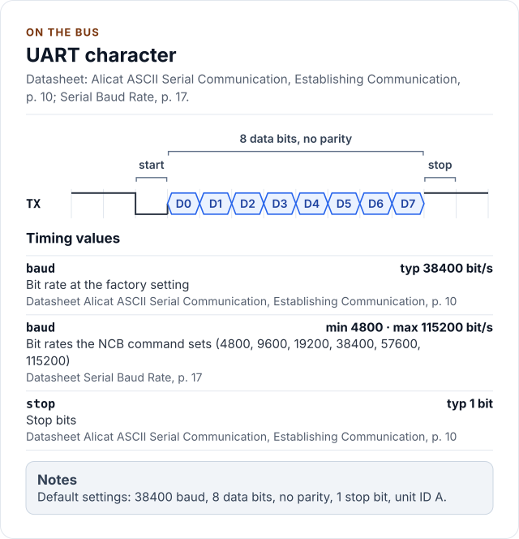
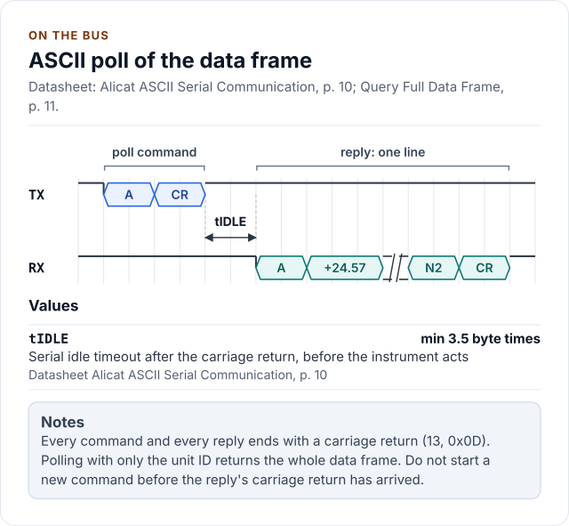
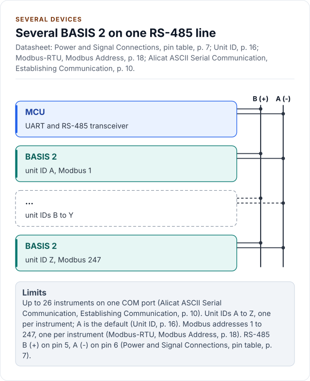

# On the bus

What the BASIS 2 needs from the serial line, with every rate and time taken from the manual. The commands and
registers are on the [Protocols](protocols.md) page and the wiring on the [Hardware](hardware.md) page; this page is
the character format and the exchange under them.

<!-- generated: datasheet-refs -->
??? abstract "Datasheet sections this page relies on"

    From Alicat Scientific, Inc. DOC-MANUAL-BASIS2 Rev 4:

    - Connector pins and serial levels: Power and Signal Connections (pin table), [p. 7](https://documents.alicat.com/manuals/DOC-MANUAL-BASIS2.pdf#page=7)
    - Default serial settings and the link layer: Alicat ASCII Serial Communication, Establishing Communication, [p. 10](https://documents.alicat.com/manuals/DOC-MANUAL-BASIS2.pdf#page=10)
    - Data frame: Data Frame Format, [p. 10](https://documents.alicat.com/manuals/DOC-MANUAL-BASIS2.pdf#page=10)
    - Query the full data frame: Query Full Data Frame, [p. 11](https://documents.alicat.com/manuals/DOC-MANUAL-BASIS2.pdf#page=11)
    - Unit ID: Unit ID, [p. 16](https://documents.alicat.com/manuals/DOC-MANUAL-BASIS2.pdf#page=16)
    - Modbus address, baud rate, command protocol: Modbus Address; Serial Baud Rate; Command Protocol, [p. 17](https://documents.alicat.com/manuals/DOC-MANUAL-BASIS2.pdf#page=17)
    - Modbus address on the line: Modbus-RTU, Modbus Address, [p. 18](https://documents.alicat.com/manuals/DOC-MANUAL-BASIS2.pdf#page=18)

    All of them, with the driver API for each: [Datasheet map](datasheet.md).
<!-- /generated -->

## UART timing

The instrument talks over RS-232 or RS-485, by model, at 38400 baud with 8 data bits, no parity and one stop bit
unless the baud rate was changed (4800 to 115200 baud). The ASCII protocol and Modbus RTU use the same character
format and the same rate.

<!-- figure: uart-timing -->
<picture>
  <source media="(prefers-color-scheme: dark)" srcset="diagrams/uart-timing.dark.svg">
  
</picture>
<!-- /figure -->

## An ASCII exchange

Every ASCII command starts with the unit ID and ends with a carriage return. The instrument does not act on a
command until the line has been idle for the time of 3.5 bytes, then answers with one line ended by a carriage
return. The driver waits for that gap before every command and never starts a new one before the reply is complete.

<!-- figure: ascii-transaction -->
<picture>
  <source media="(prefers-color-scheme: dark)" srcset="diagrams/ascii-transaction.dark.svg">
  
</picture>
<!-- /figure -->

## Modbus RTU

Modbus RTU runs on the same pins at the same baud rate. The manual lists the function codes the instrument answers
(3, 6 and 16) and the address range, but draws no Modbus frame, so this page has no Modbus waveform; the request and
reply layout the driver builds is on the [Protocols](protocols.md) page.

## Several devices

Up to 26 instruments can share one COM port. Each needs a unique unit ID (A to Z) for ASCII and a unique Modbus
address (1 to 247) for Modbus RTU; the manual asks you to connect one instrument at a time and give it its ID before
connecting the next. The manual gives no termination or cable length for the line.

<!-- figure: rs485-topology -->
<picture>
  <source media="(prefers-color-scheme: dark)" srcset="diagrams/rs485-topology.dark.svg">
  
</picture>
<!-- /figure -->

## How these figures are made

Each figure is a model in `docs/model/` (`uart-timing.timing.yml`, `ascii-transaction.timing.yml` and
`rs485-topology.topology.yml`) that cites the manual section and page of every number; `kokeb-docs figures` draws
it and the build fails on a number without a citation. The values table under each waveform is also written as
`docs/diagrams/<id>.table.html`.
