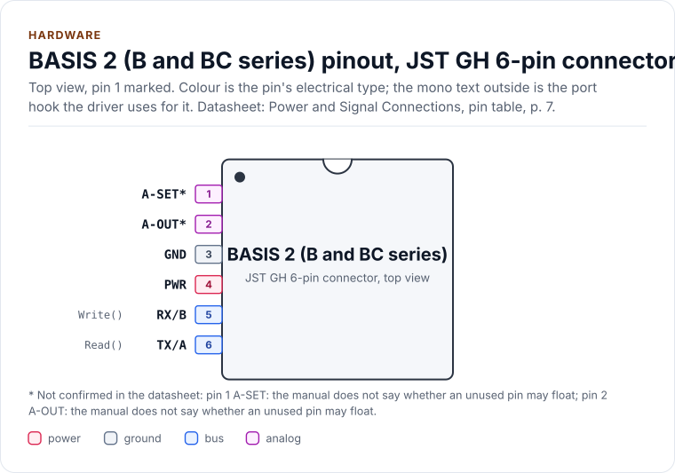
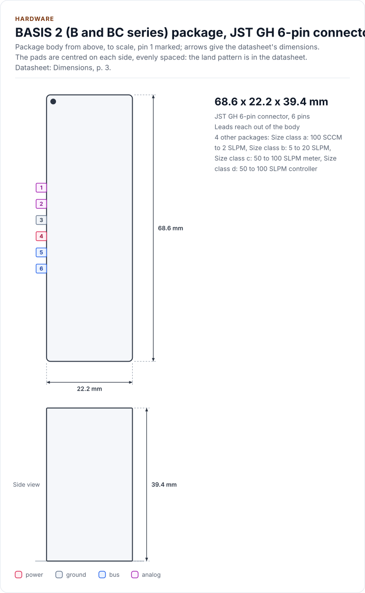
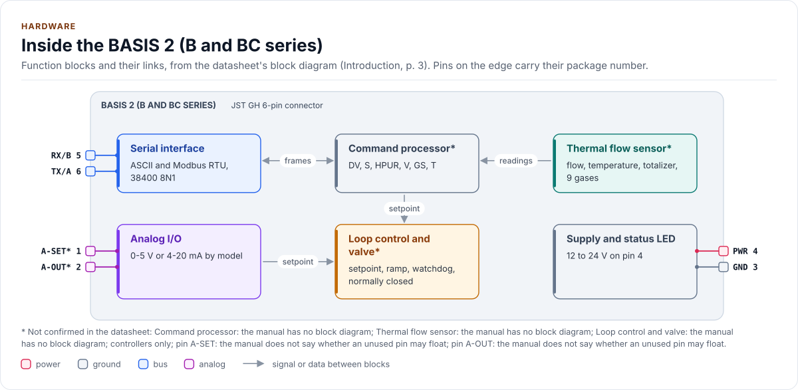
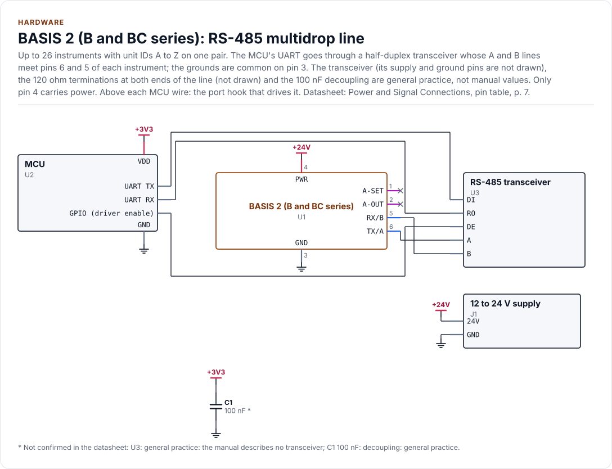
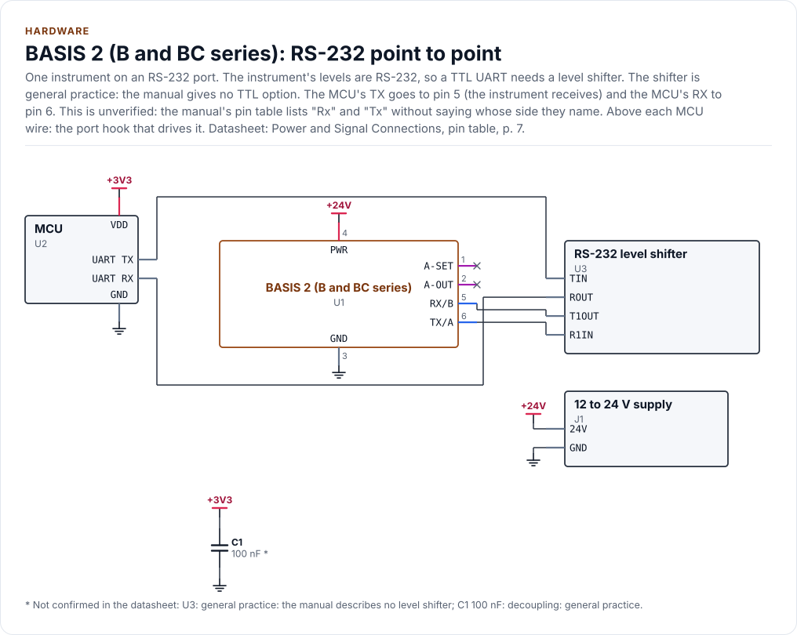

# Hardware

The connector, wiring for RS-232 and RS-485, power, LED, analog signals and size classes of the BASIS 2 meters and
controllers, as the driver uses them. The instrument is a module with one six-pin connector, not a chip in a package,
so the figures draw the connector as one row of pins.

<!-- generated: datasheet-refs -->
??? abstract "Datasheet sections this page relies on"

    - Models, ranges and options: Alicat Scientific, Inc. DOC-MANUAL-BASIS2 Rev 4, Introduction, [p. 3](https://documents.alicat.com/manuals/DOC-MANUAL-BASIS2.pdf#page=3)
    - Mounting, LED and power-up behaviour: Alicat Scientific, Inc. DOC-MANUAL-BASIS2 Rev 4, Getting Started, Mounting, [p. 5](https://documents.alicat.com/manuals/DOC-MANUAL-BASIS2.pdf#page=5)
    - Power and signal connections, pin 4 only: Alicat Scientific, Inc. DOC-MANUAL-BASIS2 Rev 4, Power and Signal Connections, [p. 6](https://documents.alicat.com/manuals/DOC-MANUAL-BASIS2.pdf#page=6)
    - Connector pins and serial levels: Alicat Scientific, Inc. DOC-MANUAL-BASIS2 Rev 4, Power and Signal Connections (pin table), [p. 7](https://documents.alicat.com/manuals/DOC-MANUAL-BASIS2.pdf#page=7)
    - Tare and autotare: Alicat Scientific, Inc. DOC-MANUAL-BASIS2 Rev 4, Taring the Instrument; Using Ground to Tare; Autotare, [p. 14](https://documents.alicat.com/manuals/DOC-MANUAL-BASIS2.pdf#page=14)
    - Analog signals: Alicat Scientific, Inc. DOC-MANUAL-BASIS2 Rev 4, Analog Signals, [p. 28](https://documents.alicat.com/manuals/DOC-MANUAL-BASIS2.pdf#page=28)
    - Supply current, accuracy and update rate: Alicat Scientific, Inc. DOC-SPECS-BASIS Rev 19, Technical Data, [p. 1](https://documents.alicat.com/specifications/DOC-SPECS-BASIS.pdf#page=1)
    - Size classes and dimensions: Alicat Scientific, Inc. DOC-SPECS-BASIS Rev 19, Dimensions, [p. 3](https://documents.alicat.com/specifications/DOC-SPECS-BASIS.pdf#page=3)

    All of them, with the driver API for each: [Datasheet map](datasheet.md).
<!-- /generated -->

!!! warning "Power on pin 4 only"
    Only connect power to pin 4, and do not switch the supply on until all the other pins are connected. Power on any
    other pin can permanently damage the instrument (manual pp. 6 and 28). Do not connect the instrument to a
    loop-powered system: it will destroy parts of the circuitry. Use an isolator and a separate supply.

!!! note "Facts that are not verified"
    Nothing here has been checked on an instrument. A fact that no document states is marked **unverified**: the
    JST GH pitch, whether an unused signal pin may float, the transceiver, the terminations and the decoupling of the
    two circuits, and the maximum supply.

## The connector

<!-- figure: chip-pinout -->
<picture>
  <source media="(prefers-color-scheme: dark)" srcset="diagrams/chip-pinout.dark.svg">
  
</picture>
<!-- /figure -->

<!-- generated: chip-pins -->
JST GH 6-pin connector, 6 pins (Power and Signal Connections, pin table, [p. 7](https://documents.alicat.com/manuals/DOC-MANUAL-BASIS2.pdf#page=7)).

| Pin | Name | Type (domain) | Function | Driver hook | If unused | Datasheet |
| --- | --- | --- | --- | --- | --- | --- |
| 1 | `A-SET` [^1] | analog (SIGNAL) | Analog setpoint input (controllers); on a meter, ground this pin for at least 25 ms to tare | - | Leave open | Using Ground to Tare (Meters), [p. 15](https://documents.alicat.com/manuals/DOC-MANUAL-BASIS2.pdf#page=15) |
| 2 | `A-OUT` [^2] | analog (SIGNAL) | Analog flow output, 0 to 5 V or 4 to 20 mA by model | - | Leave open | Analog Signals, [p. 28](https://documents.alicat.com/manuals/DOC-MANUAL-BASIS2.pdf#page=28) |
| 3 | `GND` | ground | Ground, common to power, analog and serial | - | - | Power and Signal Connections, pin table, [p. 7](https://documents.alicat.com/manuals/DOC-MANUAL-BASIS2.pdf#page=7) |
| 4 | `PWR` | power (PWR) | Power in, 12 to 24 V. Power on any other pin can permanently damage the instrument | - | - | Power and Signal Connections, [p. 6](https://documents.alicat.com/manuals/DOC-MANUAL-BASIS2.pdf#page=6) |
| 5 | `RX/B` | bus (SIGNAL) | RS-232 receive (the instrument receives, unverified: the manual does not say whose side Rx names) or RS-485 B (+), by model | `Write()` | - | Power and Signal Connections, pin table, [p. 7](https://documents.alicat.com/manuals/DOC-MANUAL-BASIS2.pdf#page=7) |
| 6 | `TX/A` | bus (SIGNAL) | RS-232 transmit (the instrument transmits, unverified: the manual does not say whose side Tx names) or RS-485 A (-), by model | `Read()` | - | Power and Signal Connections, pin table, [p. 7](https://documents.alicat.com/manuals/DOC-MANUAL-BASIS2.pdf#page=7) |

[^1]: Not confirmed in the datasheet: pin 1 (A-SET): the manual does not say whether an unused pin may float.
[^2]: Not confirmed in the datasheet: pin 2 (A-OUT): the manual does not say whether an unused pin may float.

Source of this table and of the chip figures: [`docs/hardware.yml`](hardware.yml).
<!-- /generated -->

Pin 1 does two jobs by model: on a controller it is the analog setpoint input, on a meter grounding it for at least
25 ms tares the instrument, and the tare completes when the ground is removed (manual p. 15). The serial pins carry
RS-232 or RS-485 levels, **decided by the model**, not by software; the manual describes no TTL option, so a
microcontroller UART needs a level shifter (RS-232) or a transceiver (RS-485). The driver is level-agnostic: the port
owns the physical layer.

## Size classes

<!-- figure: chip-outline -->
<picture>
  <source media="(prefers-color-scheme: dark)" srcset="diagrams/chip-outline.dark.svg">
  
</picture>
<!-- /figure -->

<!-- generated: chip-card -->
| | | Datasheet |
| --- | --- | --- |
| **Package** | JST GH 6-pin connector | Power and Signal Connections, pin table, [p. 7](https://documents.alicat.com/manuals/DOC-MANUAL-BASIS2.pdf#page=7) |
| **Pins** | 6 | Power and Signal Connections, pin table, [p. 7](https://documents.alicat.com/manuals/DOC-MANUAL-BASIS2.pdf#page=7) |
| **Body size** | 68.6 x 22.2 x 39.4 mm | Dimensions, [p. 3](https://documents.alicat.com/specifications/DOC-SPECS-BASIS.pdf#page=3) |
| **Variants** | `a`, `b`, `c`, `d` (below) | Dimensions, [p. 3](https://documents.alicat.com/specifications/DOC-SPECS-BASIS.pdf#page=3) |
| **Supply PWR** | 12.0 V to 24.0 V | Power and Signal Connections, [p. 6](https://documents.alicat.com/manuals/DOC-MANUAL-BASIS2.pdf#page=6) |

Also sold as:

| Variant | Package | Pins | Size | Ordering | Note | Datasheet |
| --- | --- | --- | --- | --- | --- | --- |
| `a` | Size class a: 100 SCCM to 2 SLPM | 6 | 68.6 x 22.2 x 39.4 mm, about 116 g | 1/8 in NPT female or SAE 4 | - | Dimensions, [p. 3](https://documents.alicat.com/specifications/DOC-SPECS-BASIS.pdf#page=3) |
| `b` | Size class b: 5 to 20 SLPM | 6 | 84.0 x 25.4 x 45.7 mm, about 171 g | 3/8 in NPT female or SAE 6 | - | Dimensions, [p. 3](https://documents.alicat.com/specifications/DOC-SPECS-BASIS.pdf#page=3) |
| `c` | Size class c: 50 to 100 SLPM meter | 6 | 95.3 x 35.0 x 48.4 mm, about 270 g | 3/8 in NPT female or SAE 6 | - | Dimensions, [p. 3](https://documents.alicat.com/specifications/DOC-SPECS-BASIS.pdf#page=3) |
| `d` | Size class d: 50 to 100 SLPM controller | 6 | 114.8 x 35.0 x 52.3 mm, about 350 g | 3/8 in NPT female or SAE 6 | options by model, not by size: analog 0-5 V or 4-20 mA; serial RS-232, RS-485 or Modbus RTU | Dimensions, [p. 3](https://documents.alicat.com/specifications/DOC-SPECS-BASIS.pdf#page=3) |

From [`docs/hardware.yml`](hardware.yml); pins, circuits and the block diagram: [Hardware](hardware.md).
<!-- /generated -->

The sheets disagree in a few cells. Revision 19 of the specification sheet (August 2026) is used here; revision 16
(March 2024) differs in dimension B of the smallest class (0.44 in against 0.53 in), in the height of the 5 to 20
SLPM class (1.83 in against 1.80 in) and in several cells of the 50 to 100 SLPM rows. Revision 19 titles itself
"through 20 slpm" but lists ten ranges; whether the 50 and 100 SLPM models are still BASIS 2 is open. The process
connection is 1/8 in NPT female or SAE 4 up to 2 SLPM and 3/8 in NPT female or SAE 6 from 5 SLPM. Mount the body
horizontally with the flow arrow parallel to the ground, on two M3 x 0.5 holes 6 mm deep.

## Inside

<!-- figure: chip-blocks -->
<picture>
  <source media="(prefers-color-scheme: dark)" srcset="diagrams/chip-blocks.dark.svg">
  
</picture>
<!-- /figure -->

## Wiring

### RS-485 multidrop

<!-- figure: chip-circuit-rs485-multidrop -->
<picture>
  <source media="(prefers-color-scheme: dark)" srcset="diagrams/chip-circuit-rs485-multidrop.dark.svg">
  
</picture>
<!-- /figure -->

Up to 26 instruments share one line, each with its own unit ID `A` to `Z` (or Modbus address). RS-485 is half duplex on
one pair: the transceiver's A line goes to pin 6 and B to pin 5. The manual describes neither the transceiver nor a
termination; a 120 ohm resistor at each end of a long line is general practice. The port owns the direction control
([Porting](porting.md#rs-485)).

### RS-232

<!-- figure: chip-circuit-rs232 -->
<picture>
  <source media="(prefers-color-scheme: dark)" srcset="diagrams/chip-circuit-rs232.dark.svg">
  
</picture>
<!-- /figure -->

One instrument per port. The MCU's TX goes through the level shifter to pin 5, where the instrument receives, and pin
6 goes through it to the MCU's RX. **Unverified:** the manual's pin table lists "Rx" and "Tx" without saying
whose side they name; check the wiring against an instrument before first power. Pin 3 is the common ground of power,
analog and serial.

## Serial settings

| Setting | Value |
| --- | --- |
| Format | 38400 baud, 8 data bits, no parity, 1 stop bit; 4800 to 115200 selectable |
| Unit ID | One letter `A` to `Z`, default `A`, unique on the line; duplicates corrupt data |
| Idle before a command | 3.5 characters after the carriage return; the instrument does not act earlier |
| Digital update rate | Up to 176 Hz, depending on baud rate and system |
| Modbus | Address 1 to 247 (register 45), the same line settings, functions 3, 6 and 16 |

Timing derived from these is on the [Protocols](protocols.md#timing) page.

## Power

| Model | Supply | Current |
| --- | --- | --- |
| Controller | 12 to 24 V on pin 4 | 210 mA |
| Meter | 12 to 24 V on pin 4 | 12 mA |
| Either, with a 4 to 20 mA analog output | | plus 40 mA |

Allow one minute for warm-up, five for best accuracy. The manual states no absolute maximum supply, no reverse polarity
protection and no ESD rating.

## Analog signals

The analog output is 0 to 5 V or 4 to 20 mA, **by model, not by software**; zero flow is about 0.010 V or 4 mA and full
scale 5.0 V or 20 mA. A controller's analog setpoint input is 0 to 5 V or 4 to 20 mA for 0 to 100 percent of full scale
and is used only while the setpoint source is `Analog` (`LSS a`). The driver reads and writes none of them.

## Status LED

| LED | Meaning |
| --- | --- |
| Solid green | Power, no errors |
| Flashing green | Serial activity |
| Fast red blink | Mass flow, temperature or totalizer over range (`MOV`, `TOV`, `OVR`) |
| Slow red blink | Valve override: a hold, or thermal management (`HLD`, `VTM`) |

## Operating limits

| Quantity | Value |
| --- | --- |
| Ambient and gas temperature | 0 to 50 C |
| Pressure | Meters 0 to 145 PSIG; controllers by valve (0 to 145, LV05 0 to 100, LV08 0 to 60); maximum common mode 145 PSIG |
| Valve | Normally closed (controllers); thermal management pulses it when a setpoint gives no flow |
| Ingress, humidity | IP40, 95 % non-condensing; a 50 micron in-line filter is suggested |
| Gases | Air, Ar, CO2, N2, O2, N2O, H2, He, CH4 |

## Reference documents

<!-- generated: datasheet-card -->
| Document | Revision | Get it |
| --- | --- | --- |
| Datasheet manual: Operating Manual for Mass Flow Instruments, BASIS 2 Meters and Controllers (Alicat Scientific, Inc. DOC-MANUAL-BASIS2) | Rev 4, 2025-05-23 | [PDF](https://documents.alicat.com/manuals/DOC-MANUAL-BASIS2.pdf) · [vendor page](https://www.alicat.com/basisoem) |
| Datasheet specification sheet: Technical Data for BASIS 2.0 Mass Flow Meters and Controllers (Alicat Scientific, Inc. DOC-SPECS-BASIS) | Rev 19, 2026-08-17 | [PDF](https://documents.alicat.com/specifications/DOC-SPECS-BASIS.pdf) · [vendor page](https://www.alicat.com/basisoem) |
| Datasheet specification sheet: Technical Data for BASIS 2 (pages 1 to 3 of the combined manual and specification file) (Alicat Scientific, Inc. MANUAL+SPECS_BASIS2) | Rev 16, 2024-03-01 | [PDF](https://documents.alicat.com/specifications/MANUAL+SPECS_BASIS2.pdf) · [vendor page](https://www.alicat.com/basisoem) |
| Datasheet manual: Alicat Modbus Manual (generic, written for the classic registers) (Alicat Scientific, Inc. DOC-MANUAL-MODBUS) | Rev 7, 2024-11-01 | [PDF](https://documents.alicat.com/manuals/DOC-MANUAL-MODBUS.pdf) · [vendor page](https://www.alicat.com/basisoem) |
| Datasheet application note: Alicat Serial Communications Primer (classic line, firmware 4v to 10v) (Alicat Scientific, Inc. Alicat-Serial-Primer) | Rev 2, 2023-02-01 | [PDF](https://documents.alicat.com/Alicat-Serial-Primer.pdf) · [vendor page](https://www.alicat.com/basisoem) |

Written against these revisions; the SHA-256 of each file is in [`docs/datasheets.yml`](datasheets.yml). Where each part
of the driver is in the datasheet: [Datasheet map](datasheet.md).
<!-- /generated -->

| Also useful | Contents |
| --- | --- |
| [`inc/alicat_basis2_registers.hpp`](../inc/alicat_basis2_registers.hpp) | The Modbus register table as the driver uses it |
| [`docs/hardware.yml`](hardware.yml) | The connector, blocks and circuits behind the figures |
