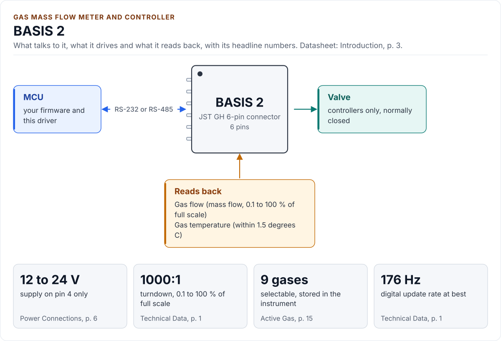
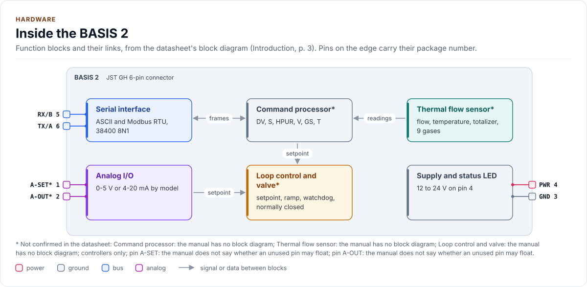
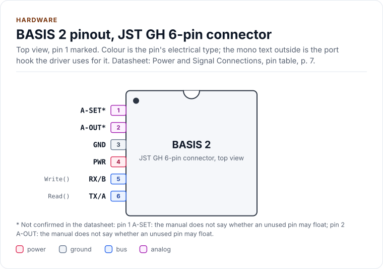
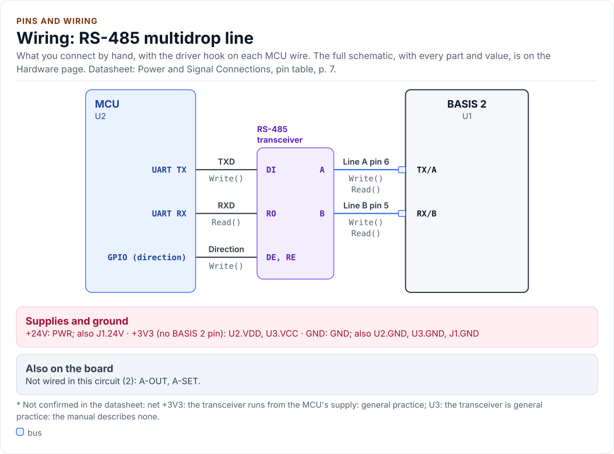
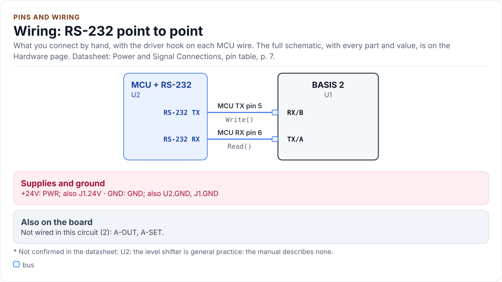

---
hide:
  - navigation
  - toc
---

<div class="kb-hero" markdown>
<span class="kb-kicker">Gas mass flow meter and controller</span>

# BASIS 2 Driver

<p>A C++20 driver for the Alicat BASIS 2 gas mass flow meters (B series) and controllers (BC series). It reads
flow, temperature and totals, sets setpoints and valve holds, and speaks both the ASCII protocol and Modbus RTU
behind one API, on any MCU.</p>

[Quickstart](quickstart.md){ .md-button .md-button--primary }
[API guide](api-guide.md){ .md-button }
[Source on GitHub](https://github.com/kokeb-labs-drivers/driver-alicat-basis2){ .md-button }
</div>

<!-- generated: chip-summary -->
The **BASIS 2** is a family of gas mass flow meters (B series) and controllers (BC series): it reports the flow,
temperature and total of nine gases, and a controller sets the flow with its own valve (Introduction, [p.
3](https://documents.alicat.com/manuals/DOC-MANUAL-BASIS2.pdf#page=3)).
<!-- /generated -->

<!-- figure: chip-hero -->
<picture>
  <source media="(prefers-color-scheme: dark)" srcset="diagrams/chip-hero.dark.svg">
  
</picture>
<!-- /figure -->

## What it does

<!-- figure: chip-capabilities -->
<picture>
  <source media="(prefers-color-scheme: dark)" srcset="diagrams/chip-capabilities.dark.svg">
  
</picture>
<!-- /figure -->

## Where it is used

<!-- generated: chip-uses -->
- Logging flow data to a PC over the serial line
- Flow control from software, over a digital link or with analog signals

Uses named by the datasheet (Introduction, [p. 3](https://documents.alicat.com/manuals/DOC-MANUAL-BASIS2.pdf#page=3)).
<!-- /generated -->

## Inside the module

<!-- figure: chip-blocks -->
<picture>
  <source media="(prefers-color-scheme: dark)" srcset="diagrams/chip-blocks.dark.svg">
  
</picture>
<!-- /figure -->

## Pins and wiring

<!-- figure: chip-pinout -->
<picture>
  <source media="(prefers-color-scheme: dark)" srcset="diagrams/chip-pinout.dark.svg">
  
</picture>
<!-- /figure -->

<!-- figure: chip-wiring-rs485-multidrop -->
<picture>
  <source media="(prefers-color-scheme: dark)" srcset="diagrams/chip-wiring-rs485-multidrop.dark.svg">
  
</picture>
<!-- /figure -->

<!-- figure: chip-wiring-rs232 -->
<picture>
  <source media="(prefers-color-scheme: dark)" srcset="diagrams/chip-wiring-rs232.dark.svg">
  
</picture>
<!-- /figure -->

Every pin, both circuits, the serial settings, the LED and the size classes: [Hardware](hardware.md).

## Quick start

Wire the instrument as above, write the port ([Porting](porting.md)), then read a flow:

```cpp
--8<-- "tests/docs/quickstart.cpp:quickstart"
```

The steps explained: [Quickstart](quickstart.md).

## Driver coverage

<!-- generated: chip-coverage -->
| Capability | What the chip does | Driver API | Registers | Status | Datasheet |
| --- | --- | --- | --- | --- | --- |
| [Flow, temperature and total](api-guide.md) | Polls the whole data frame or single items and decodes each number exactly | `ReadFrame`, `ReadData`, `ReadFlow`, `ReadTemperature`, `ReadTotal`, `ReadStatus` | `kFlow`, `kTemperature`, `kTotal`, `kStatus` | Supported | Data Frame Format, [p. 10](https://documents.alicat.com/manuals/DOC-MANUAL-BASIS2.pdf#page=10) |
| [Setpoint, ramp and watchdog](safety.md) | Sets the flow of a controller, limits how fast it changes and closes the valve if the line goes quiet (controllers only; the watchdog acts only on Modbus setpoints from an unsaved digital source) | `SetSetpoint`, `SetSetpointSource`, `SetRamp`, `DisableRamp`, `SetWatchdog` | `kSetpoint`, `kSetpointType`, `kRamp`, `kWatchdog` | Supported | Setpoint; Setpoint Source; Maximum Setpoint Ramp Rate, [p. 11](https://documents.alicat.com/manuals/DOC-MANUAL-BASIS2.pdf#page=11) |
| [Valve hold and loop gains](safety.md) | Holds the valve at a fixed drive, opens or closes it, and tunes the closed loop (controllers only) | `HoldValve`, `ResumeControl`, `OpenValve`, `CloseValve`, `SetGains` | `kGainP`, `kGainI` | Supported | Hold Valve Position / Resume Flow; Loop Control Gains, [p. 13](https://documents.alicat.com/manuals/DOC-MANUAL-BASIS2.pdf#page=13) |
| [Tare and autotare](api-guide.md) | Zeroes the flow reading at no flow, and on a controller zeroes it again at a closed setpoint | `Tare`, `TareDefault`, `SetAutotare` | `kTare`, `kTareSamples`, `kAutotare` | Supported | Taring the Instrument, [p. 14](https://documents.alicat.com/manuals/DOC-MANUAL-BASIS2.pdf#page=14) |
| [Gas selection](api-guide.md) | Selects one of the nine calibrated gases and lists the gases the instrument holds | `SetGas`, `ReadGas`, `ReadGasList`, `ReadGasTable` | `kGas`, `kGasTable` | Supported | Active Gas, [p. 15](https://documents.alicat.com/manuals/DOC-MANUAL-BASIS2.pdf#page=15) |
| [Totalizer and batch](api-guide.md) | Counts the gas that has passed, sets what happens at the limit, and dispenses a set volume (batch on controllers only) | `ResetTotal`, `SetTotalizerLimit`, `SetBatch`, `DisableBatch`, `ReadBatchRemaining` | `kTotalReset`, `kTotalLimit`, `kBatch`, `kBatchRemaining` | Supported | Totalizer Reset; Totalizer Batch; Totalizer Configuration, [p. 15](https://documents.alicat.com/manuals/DOC-MANUAL-BASIS2.pdf#page=15) |
| [Measurement window](api-guide.md) | Starts a timed measurement, by command or by an event, and reads its averages and ranges (controllers only) | `SetMeasurementTrigger`, `StartMeasurement`, `ReadAverages`, `ReadRanges`, `ReadPreviousMeasurement` | `kTrigger`, `kSamples` | Supported | Configure Measurement Triggering; Measurement Averages and Ranges, [p. 13](https://documents.alicat.com/manuals/DOC-MANUAL-BASIS2.pdf#page=13) |
| [Unit ID, baud and protocol](safety.md) | Changes the unit ID, address, baud rate or protocol, restores factory settings, and scans a line (each change needs a confirmation token) | `ChangeUnitId`, `SetModbusAddress`, `ChangeBaud`, `SwitchToProtocol1`, `FactoryRestore`, `ScanUnitIds` | `kUnitId`, `kModbusAddress`, `kBaud`, `kProtocol`, `kFactoryRestore` | Guarded | Unit ID, [p. 16](https://documents.alicat.com/manuals/DOC-MANUAL-BASIS2.pdf#page=16) |
| [Analog setpoint and output](hardware.md) | A 0 to 5 V or 4 to 20 mA setpoint input and flow output on pins 1 and 2, wired outside the driver | - | - | Not covered | Analog Signals, [p. 28](https://documents.alicat.com/manuals/DOC-MANUAL-BASIS2.pdf#page=28) |

**Supported**: the driver covers it and a host test checks it; **Guarded**: covered, behind an explicit acknowledgement
because a wrong value can do harm; **Not covered**: the chip has it and the driver leaves it alone.

From [`docs/hardware.yml`](hardware.yml); `kokeb-docs hardware --check` confirms that every API name is in
`inc/alicat_basis2.hpp`, `inc/alicat_basis2_types.hpp` and every register in `inc/alicat_basis2_registers.hpp`.
<!-- /generated -->

The driver has no platform code. You give it a small class that moves bytes on a serial line and tells the time; it
does the rest: the unit ID and silent-interval rules of the line, frame parsing, unit and decimal handling, Modbus
framing and CRC, retries of reads, and the guards around the commands that can strand an instrument.

- **One object per instrument.** `Basis2<YourPort>` sits on a `Bus<YourPort>` that owns the serial line, so up to 26
  instruments share one line. See [API guide](api-guide.md).
- **Two protocols, one API.** `Config::protocol` selects ASCII or Modbus RTU; the calls do not change. See
  [Protocols](protocols.md).
- **Errors you can act on.** Every call returns `Result<T>` with an `Error` such as `Timeout`, `DeviceIdMismatch` or
  `VerifyMismatch`. See [Troubleshooting](troubleshooting.md).
- **Guarded commands.** The six commands that can leave an instrument unreachable need a token that names the
  consequence. See [Safety notes](safety.md).
- **A port of five hooks.** `Write`, `Read`, `FlushInput`, `NowMs` and `EnsureInitialized`, plus optional `DelayMs`,
  `SetBaud` and `Log`. See [Porting](porting.md).
- **No heap, no exceptions, no RTTI.** See [Contract](contract.md).
- **Tested without hardware.** An independent model instrument with a byte-accurate wire, fault injection and four
  fuzz targets. See [Testing and CI](testing.md). Nothing has been run on an instrument yet.

## Datasheet

<!-- generated: datasheet-card -->
| Document | Revision | Get it |
| --- | --- | --- |
| Datasheet manual: Operating Manual for Mass Flow Instruments, BASIS 2 Meters and Controllers (Alicat Scientific, Inc. DOC-MANUAL-BASIS2) | Rev 4, 2025-05-23 | [PDF](https://documents.alicat.com/manuals/DOC-MANUAL-BASIS2.pdf) · [vendor page](https://www.alicat.com/basisoem) |
| Datasheet specification sheet: Technical Data for BASIS 2.0 Mass Flow Meters and Controllers (Alicat Scientific, Inc. DOC-SPECS-BASIS) | Rev 19, 2026-08-17 | [PDF](https://documents.alicat.com/specifications/DOC-SPECS-BASIS.pdf) · [vendor page](https://www.alicat.com/basisoem) |
| Datasheet specification sheet: Technical Data for BASIS 2 (pages 1 to 3 of the combined manual and specification file) (Alicat Scientific, Inc. MANUAL+SPECS_BASIS2) | Rev 16, 2024-03-01 | [PDF](https://documents.alicat.com/specifications/MANUAL+SPECS_BASIS2.pdf) · [vendor page](https://www.alicat.com/basisoem) |
| Datasheet manual: Alicat Modbus Manual (generic, written for the classic registers) (Alicat Scientific, Inc. DOC-MANUAL-MODBUS) | Rev 7, 2024-11-01 | [PDF](https://documents.alicat.com/manuals/DOC-MANUAL-MODBUS.pdf) · [vendor page](https://www.alicat.com/basisoem) |
| Datasheet application note: Alicat Serial Communications Primer (classic line, firmware 4v to 10v) (Alicat Scientific, Inc. Alicat-Serial-Primer) | Rev 2, 2023-02-01 | [PDF](https://documents.alicat.com/Alicat-Serial-Primer.pdf) · [vendor page](https://www.alicat.com/basisoem) |

Written against these revisions; the SHA-256 of each file is in [`docs/datasheets.yml`](datasheets.yml). Where each part
of the driver is in the datasheet: [Datasheet map](datasheet.md).
<!-- /generated -->

## Where to go next

<div class="grid cards" markdown>

-   :material-rocket-launch-outline: **[Quickstart](quickstart.md)**

    ---

    Wire the instrument, write the port, read a flow in about 20 lines.

-   :material-chip: **[Hardware](hardware.md)**

    ---

    The connector, wiring for RS-232 and RS-485, power, LED and the size classes.

-   :material-shield-alert-outline: **[Safety notes](safety.md)**

    ---

    Valve holds, the watchdog, saved setpoints, tare, and the guarded commands.

-   :material-code-braces: **[API guide](api-guide.md)**

    ---

    Start up, read, set, scan and recover, task by task.

-   :material-swap-horizontal: **[Porting](porting.md)**

    ---

    Implement the port, RS-485 direction and baud switching.

-   :material-book-open-variant: **[API reference](api-reference.md)**

    ---

    Every class and member, generated from the headers.

</div>
